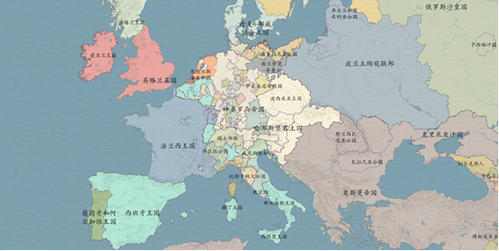

# 三十年战争研究

> 一场影响欧洲近代格局的宗教与政治战争（1618-1648）—— 2025-006 项目
  
*三十年战争时期的欧洲政治格局*
## 目录结构
- `Body/` -存放主要内容
- `Note`  -存放零时想法

## 使用方法（包括INDEX）

### 项目简介
本项目专注于**三十年战争**（The Thirty Years' War，1618-1648）的历史研究。这是一场以宗教冲突为导火索，最终演变为欧洲大国争夺霸权的全面战争，对欧洲近代国家的形成、国际关系格局和宗教格局产生了深远影响。

**研究内容**：战争起因、主要阶段、参与势力、战争影响及《威斯特伐利亚和约》的历史意义。

**制作团队**：陈煜暄、娄必辉、谢子豪、刘雨乐、张航诚

---

### PPT 演示文稿（核心资料）
- **[三十年战争完整版.pptx](./5-Office/三十年战争PPT.(xl).pptx)** （主讲稿）
- **[三十年战争 - 影响与启示.pptx](./5-Office/三十年战争PPT.影响与启示(x).pptx)** （影响部分深化）

### 1. 战争起因
- 宗教冲突（天主教 vs 新教）
- 政治动态（法国 vs 哈布斯堡王朝、北方国家扩张）
- 经济因素（资源争夺、农民不满）

### 2. 战争过程（四个阶段）
1. **波希米亚阶段**（1618-1623）
2. **丹麦阶段**（1625-1629）
3. **瑞典阶段**（1630-1634）
4. **法国阶段**（1635-1648）

### 3. 战争影响
- **政治**：德意志分裂、《威斯特伐利亚和约》奠定近代国际关系基础
- **宗教**：新教与天主教平等共存
- **人口与经济**：德意志人口锐减60%，经济严重破坏
- **大国兴衰**：法国崛起、西班牙衰落、瑞典称霸波罗的海、荷兰独立

---

## 项目文件索引

- **[主要演示文稿](./5-Office/三十年战争PPT.(xl).pptx)**
- **[影响与启示](./5-Office/三十年战争PPT.影响与启示(x).pptx)**
---

## 保留内容

### logo与作者

- 作者：pinavia
- 

### 学习许可与权利保留

- 本项目允许个人、学校和研究者进行非商业性的学习、研究和引用。
- 未经著作权人书面许可，不得将项目内容用于商业开发、产品制造、商业服务、商业宣传、投标交付、毕业设计成品交付或再授权。
- 不得删除作者、来源、版本历史和第三方许可证声明，不得将本项目或其衍生成果宣称为与作者无关的原创项目。
- 软件源码适用 [PolyForm Noncommercial 1.0.0](https://polyformproject.org/licenses/noncommercial/1.0.0/)；机械模型、PCB、原理图、图片、文档、Unity 工程和其他非软件资料适用 [CC BY-NC-ND 4.0](https://creativecommons.org/licenses/by-nc-nd/4.0/)。
- SE、SW、STEP/STP 及其他三维模型仅允许个人或学校进行非商业学习、评审和研究；未经著作权人书面许可，不得用于加工、打样、制造、销售、量产、投标、产品交付、商业宣传、改作或再授权。
- 第三方组件、模板、元件库、外购件模型和工具仍受其原始许可证约束；本声明不扩大作者对第三方内容的权利。

商业使用、产品化、公司内部长期使用、转让或排他性授权需另行取得著作权人的书面许可。
